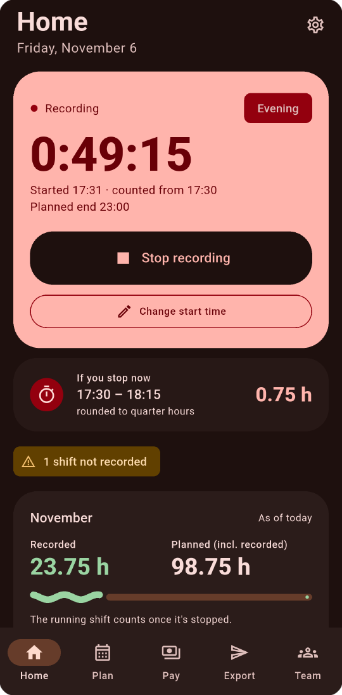
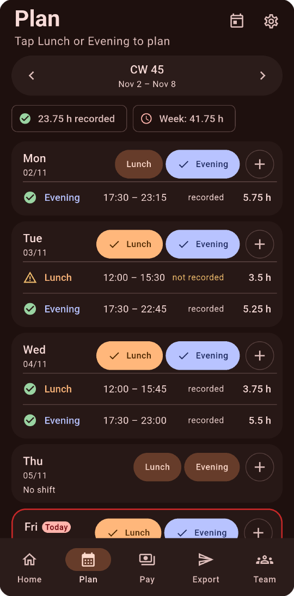
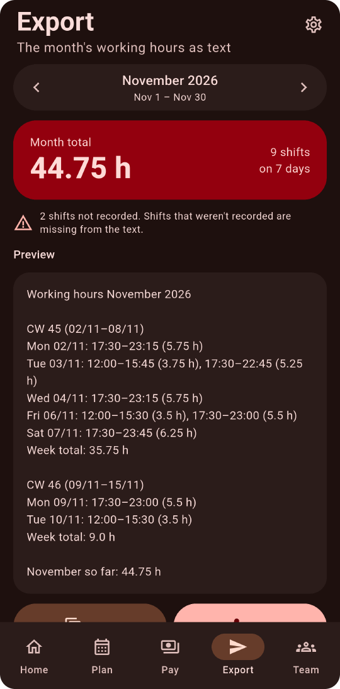
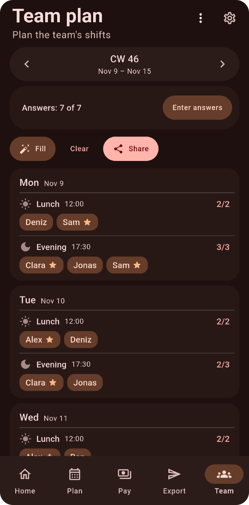
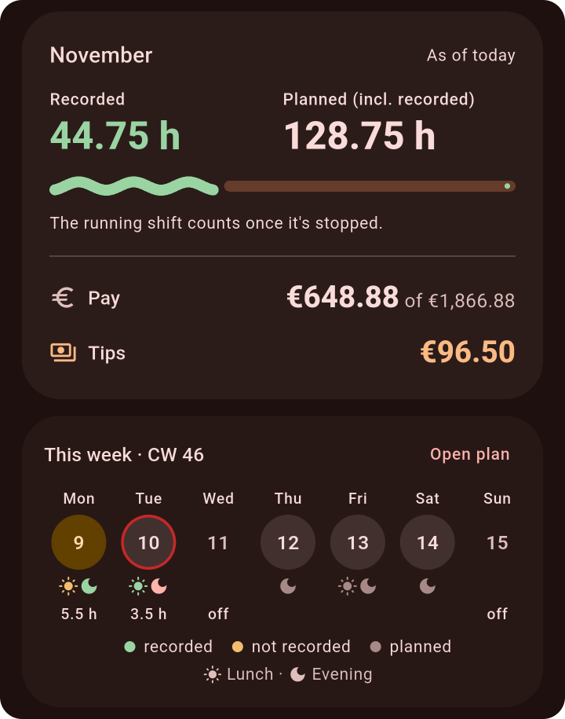
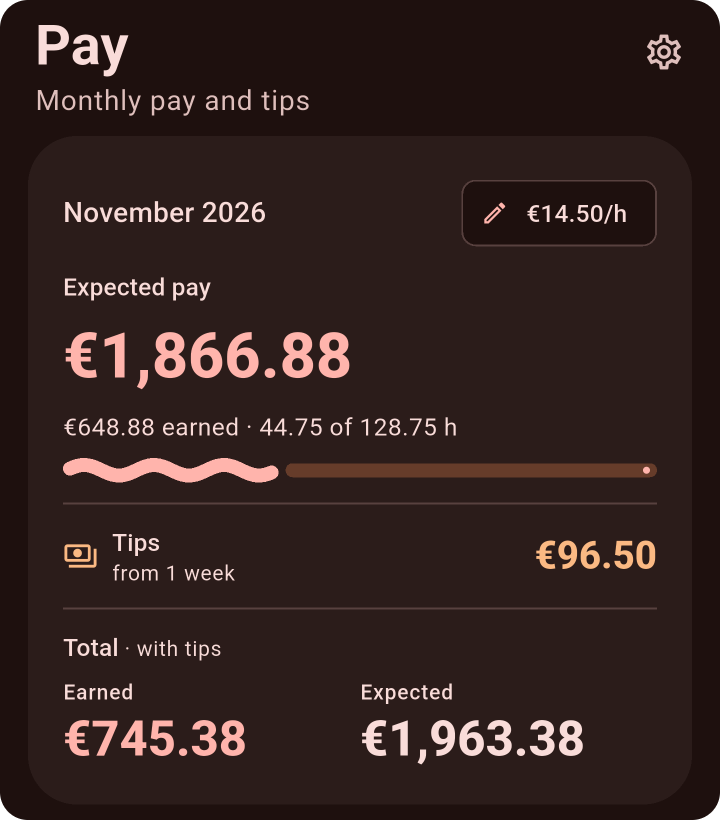
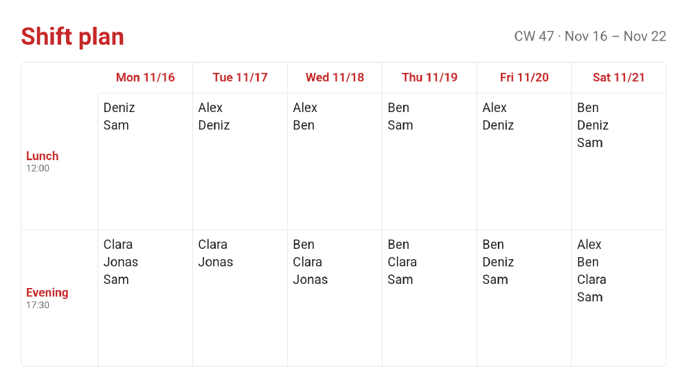
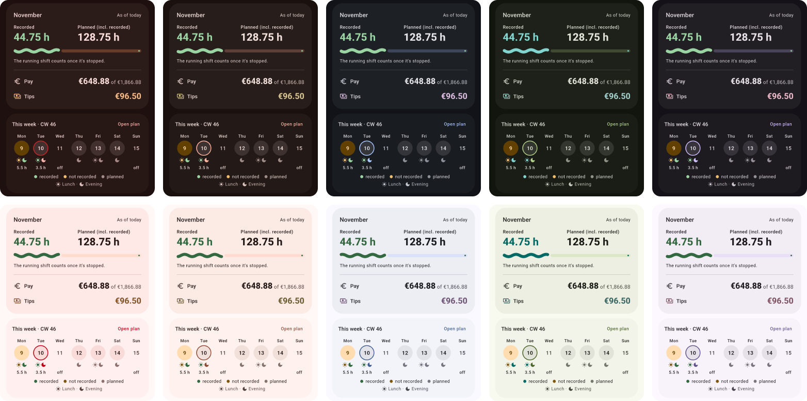

<p align="center">
  
</p>

<h1 align="center">TimeTrack</h1>

<p align="center">
  An Android app for restaurant shifts.<br>
  Plan lunch and evening shifts, record the hours worked, and send the month's hours as text.
</p>

<p align="center">
  <a href="https://github.com/Kraechtshammer/akai-timetrack/releases/latest"></a>
  <a href="https://github.com/Kraechtshammer/akai-timetrack/actions/workflows/ci.yml"></a>
</p>

<p align="center">
  
  
  
  
</p>

TimeTrack was made for restaurant service staff. A waiter plans shifts on paper, records the hours worked and sends them to the boss at the end of the month. The app does those steps on the phone.

- Android 10 or newer.
- German by default, English in the settings.
- No account and no server. All data stays on the phone.

The screenshots show the English UI in dark mode with demo data.

## Features

### Plan shifts

- Tap "Lunch" or "Evening" on a day to plan a shift with the default times: 12:00–16:00 and 17:30–23:00. Lunch ends at 15:30 when an evening shift follows. "+" adds a shift with other times.
- Planned shifts appear in a Google calendar the user picks, in a chosen colour. Anyone who shares that calendar sees them. The app writes through Android's own calendar, so it needs no Google login or API key.
- A reminder comes 15 minutes before each shift, with a "Start recording" button. The lead time is a setting.

### Record the hours

- Start from the reminder or from the Home tab. While recording, a notification shows the elapsed time, a progress bar and a "Stop" button. On Android 16 the app asks for this notification to be shown as a Live Update.
- On "Stop", the times are rounded to the quarter hour. The rounding rule is a setting. If the planned end is 30 minutes past, the app asks "Still at work?".
- Start and end times can be corrected by hand afterwards.
- The Home tab shows the month so far: recorded and planned hours, pay, tips and the current week.

<p align="center">
  
</p>

### Pay and tips

- The "Hourly wage" has a start date, so a raise doesn't change past months.
- The Pay tab shows the expected pay for the month and the amount earned so far: the hours times the hourly wage.
- Tips are recorded two ways: "Paid out" (the cash the user got for the week) and, if turned on in Settings › Features, the "Daily pool" (everyone's tips combined that day). Both are only for the user's records.

<p align="center">
  
</p>

### Export

- The Export tab builds a text of the month's hours, grouped by calendar week, with week and month totals.
- "Copy" puts it on the clipboard; "Share" sends it to WhatsApp, Signal, SMS or any other app.
- Shifts that weren't recorded are left out, and the app says how many.

### Team planner (optional)

Off by default; turn it on in Settings › Features › "Team planner". It is for weeks when the user plans the shifts of the whole service team.

1. Add the people. Mark experienced staff as "Core worker".
2. Enter each person's answer for the week: "Can work" or "Can't work", per day or per shift, or "Away this week".
3. "Fill" puts people into the shifts. Each shift gets one core worker first. The other places go to people who aren't core workers first, and to those with the fewest shifts.
4. Change anything by hand, then "Share" sends the week as a picture to the team chat.
5. "Add my shifts to Plan" copies the user's own shifts into the Plan tab. Or turn on "Sync my shifts with Plan" in Settings › Team planner: the shifts then come and go by themselves (recorded ones stay), and taking one off Plan takes the user out of the team shift too.
6. For mini-jobs, a person can have "Max. hours per month". "Hours per month" (the hourglass on the board) shows everyone's planned hours against it. The shift sheet and the board warn when someone would go over it, or take more than this week's share of what is left plus one long shift; tap the warning for the numbers. Fill never plans anyone beyond either. Planned shifts are counted with the shift times from Settings › Shifts.

<p align="center">
  
</p>

### Colours

- Five colour themes, each in light and dark mode: "Red" (the default), "Terracotta", "Blue", "Green" and "Violet". "System color" takes the colours from the phone's wallpaper (Android 12 and newer).
- Shifts have their own soft colours on top of the theme: green for recorded, honey for not recorded, grey for planned. On the Plan tab, lunch is apricot and evening is periwinkle.
- When one of these would look like the theme colour, it moves to a neighbouring colour. With "Green", for example, recorded shifts are teal.

<p align="center">
  
</p>

### Other details

- The restaurant's name is set in the setup. It goes into the calendar events' location, the export and the team plan picture.
- Launcher icons in a few designs (a serving cloche by default, and some secret ones), each in three shapes, because launchers use different icon shapes: round, squircle and small squircle.
- The app checks GitHub for a new release, shows what changed, downloads the APK and hands it to Android's installer. After the update it shows what's new once more; Settings › App update › "What's new" shows it again.

## Install

1. Download the APK from the [latest release](https://github.com/Kraechtshammer/akai-timetrack/releases/latest).
2. Open it on the phone. Android asks to allow installing apps from the browser or file manager.
3. Later updates arrive in the app.

## Build

The project builds in a dev container with Flutter, the Android SDK and an emulator. The setup is described in [docs/03-dev-setup.md](docs/03-dev-setup.md).

```bash
flutter analyze                    # must report no issues
flutter test
bash scripts/build-apk.sh debug    # APK into dist/
adb install -r dist/<apk>
```

| Part | Used for |
|---|---|
| Flutter, [Material 3 Expressive](https://pub.dev/packages/material_3_expressive) | UI |
| [drift](https://pub.dev/packages/drift) (SQLite) | shifts, tips, wages, team plans |
| [Riverpod](https://pub.dev/packages/flutter_riverpod) | app state |
| [flutter_local_notifications](https://pub.dev/packages/flutter_local_notifications) | reminders and the recording notification |
| `packages/calendar_bridge` (Kotlin) | reading and writing Android calendar events |
| `packages/running_progress` (Kotlin) | the progress bar in the recording notification, Live Update on Android 16 |
| GitHub Actions | checks on every push; signed APK and release on each `v*` tag |

## Docs

- [docs/HANDOFF.md](docs/HANDOFF.md): current state, open points, code map
- [docs/01-research.md](docs/01-research.md): problem, features, platform research, decisions
- [docs/02-design.md](docs/02-design.md): architecture, data model, sync and notification flows, screens
- [docs/03-dev-setup.md](docs/03-dev-setup.md): dev container, phone and emulator, VS Code tasks, releases
- [docs/concepts/](docs/concepts/): the approved UI concept screens
